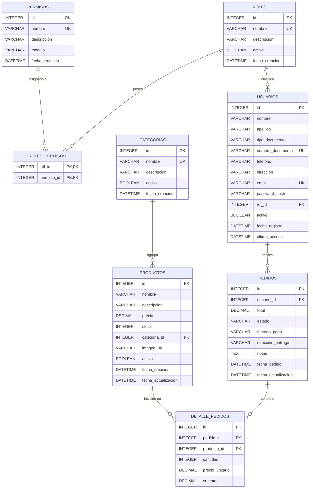

# Modelo Entidad-Relación y Diccionario de Datos
## Pastelería Artesanal Dulce Delicia

---

### 1. Descripción General del Sistema de Base de Datos

El sistema de base de datos de **Dulce Delicia** está diseñado bajo los principios del modelo relacional para soportar de manera eficiente, segura y escalable la gestión integral de la pastelería artesanal.

Cubre los siguientes módulos funcionales:
1. **Control de Acceso Basado en Roles (RBAC):** Gestión granular de roles (`roles`), permisos del sistema (`permisos`) y su asociación muchos a muchos (`roles_permisos`).
2. **Gestión de Usuarios y Clientes:** Almacenamiento seguro de credenciales con hash criptográfico, datos personales, tipos de documento, teléfonos y estados de actividad (`usuarios`).
3. **Catálogo de Repostería y Productos:** Clasificación por categorías (`categorias`) y control de inventario, precios unitarios, imágenes y disponibilidad en vitrina (`productos`).
4. **Ventas y Pedidos:** Registro transaccional de órdenes de compra (`pedidos`) y sus líneas de detalle individuales (`detalle_pedidos`) para garantizar trazabilidad e integridad financiera.

---

### 2. Diagrama Entidad-Relación (Mermaid)

---

### 3. Diccionario de Datos Exhaustivo

#### 3.1. Tabla: `roles`
Define los perfiles de usuario permitidos dentro de la plataforma (ej. Administrador, Empleado, Cliente).

| Campo | Tipo de Dato | Nulo | Clave | Valor por Defecto | Restricciones / Validación | Descripción |
| :--- | :--- | :---: | :---: | :---: | :--- | :--- |
| `id` | INTEGER | NO | PK | Autoincrement | Mayor a 0 | Identificador único del rol |
| `nombre` | VARCHAR(50) | NO | UK | - | Único, no vacío | Nombre descriptivo del rol |
| `descripcion` | VARCHAR(255) | SÍ | - | NULL | - | Alcance y funciones del rol |
| `activo` | BOOLEAN | NO | - | 1 / TRUE | 0 o 1 | Estado de disponibilidad del rol |
| `fecha_creacion` | DATETIME | NO | - | CURRENT_TIMESTAMP | Fecha válida | Marca de tiempo de registro |

---

#### 3.2. Tabla: `permisos`
Almacena las acciones atómicas que pueden ser ejecutadas en los distintos módulos del sistema.

| Campo | Tipo de Dato | Nulo | Clave | Valor por Defecto | Restricciones / Validación | Descripción |
| :--- | :--- | :---: | :---: | :---: | :--- | :--- |
| `id` | INTEGER | NO | PK | Autoincrement | Mayor a 0 | Identificador único del permiso |
| `nombre` | VARCHAR(100) | NO | UK | - | Único (ej. `productos:crear`) | Nombre técnico del permiso |
| `descripcion` | VARCHAR(255) | SÍ | - | NULL | - | Descripción funcional de la acción |
| `modulo` | VARCHAR(50) | NO | - | - | usuarios, productos, etc. | Módulo al que pertenece |
| `fecha_creacion` | DATETIME | NO | - | CURRENT_TIMESTAMP | Fecha válida | Marca de tiempo de creación |

---

#### 3.3. Tabla: `roles_permisos`
Tabla asociativa que materializa la relación muchos a muchos entre roles y permisos.

| Campo | Tipo de Dato | Nulo | Clave | Valor por Defecto | Restricciones / Validación | Descripción |
| :--- | :--- | :---: | :---: | :---: | :--- | :--- |
| `rol_id` | INTEGER | NO | PK, FK | - | Referencia a `roles(id)` ON DELETE CASCADE | Identificador del rol |
| `permiso_id` | INTEGER | NO | PK, FK | - | Referencia a `permisos(id)` ON DELETE CASCADE | Identificador del permiso |

---

#### 3.4. Tabla: `usuarios`
Gestiona la información de usuarios registrados, administradores, dependientes y clientes.

| Campo | Tipo de Dato | Nulo | Clave | Valor por Defecto | Restricciones / Validación | Descripción |
| :--- | :--- | :---: | :---: | :---: | :--- | :--- |
| `id` | INTEGER | NO | PK | Autoincrement | Mayor a 0 | Identificador único del usuario |
| `nombre` | VARCHAR(100) | NO | - | - | Solo caracteres alfabéticos | Nombre(s) de la persona |
| `apellido` | VARCHAR(100) | NO | - | - | Solo caracteres alfabéticos | Apellido(s) de la persona |
| `tipo_documento` | VARCHAR(20) | NO | - | 'CC' | CC, CE, TI, PASAPORTE, NIT | Tipo de identificación oficial |
| `numero_documento`| VARCHAR(30) | NO | UK | - | Alfanumérico único | Número de identificación oficial |
| `telefono` | VARCHAR(25) | SÍ | - | NULL | Formato telefónico válido | Teléfono o celular de contacto |
| `direccion` | VARCHAR(200) | SÍ | - | NULL | No nulo si requiere delivery | Dirección física de residencia/entrega |
| `email` | VARCHAR(150) | NO | UK | - | Formato de correo RFC 5322 | Correo electrónico de inicio de sesión |
| `password_hash` | VARCHAR(255) | NO | - | - | Hash seguro (Bcrypt / Argon2) | Clave protegida criptográficamente |
| `rol_id` | INTEGER | NO | FK | - | Referencia a `roles(id)` ON RESTRICT | Rol asignado al usuario |
| `activo` | BOOLEAN | NO | - | 1 / TRUE | 0 o 1 | Estado de habilitación de la cuenta |
| `fecha_registro` | DATETIME | NO | - | CURRENT_TIMESTAMP | Fecha válida | Momento de alta en la plataforma |
| `ultimo_acceso` | DATETIME | SÍ | - | NULL | - | Registro de última sesión iniciada |

---

#### 3.5. Tabla: `categorias`
Clasificación de la pastelería artesanal (Tortas, Postres Fríos, Cafetería, etc.).

| Campo | Tipo de Dato | Nulo | Clave | Valor por Defecto | Restricciones / Validación | Descripción |
| :--- | :--- | :---: | :---: | :---: | :--- | :--- |
| `id` | INTEGER | NO | PK | Autoincrement | Mayor a 0 | Identificador único de la categoría |
| `nombre` | VARCHAR(100) | NO | UK | - | Único, no vacío | Nombre de la categoría de postres |
| `descripcion` | TEXT | SÍ | - | NULL | - | Descripción de la variedad o técnica |
| `activo` | BOOLEAN | NO | - | 1 / TRUE | 0 o 1 | Disponibilidad en vitrina y web |
| `fecha_creacion` | DATETIME | NO | - | CURRENT_TIMESTAMP | Fecha válida | Fecha de registro de la categoría |

---

#### 3.6. Tabla: `productos`
Almacena el catálogo de delicias y postres artesanales de "Dulce Delicia".

| Campo | Tipo de Dato | Nulo | Clave | Valor por Defecto | Restricciones / Validación | Descripción |
| :--- | :--- | :---: | :---: | :---: | :--- | :--- |
| `id` | INTEGER | NO | PK | Autoincrement | Mayor a 0 | Identificador único del postre |
| `nombre` | VARCHAR(150) | NO | - | - | No vacío | Nombre comercial del producto |
| `descripcion` | TEXT | NO | - | - | Ingredientes y presentación | Descripción gourmet del postre |
| `precio` | DECIMAL(10,2)| NO | - | 0.00 | `CHECK (precio >= 0)` | Precio de venta en pesos ($ COP) |
| `stock` | INTEGER | NO | - | 0 | `CHECK (stock >= 0)` | Unidades disponibles en stock |
| `categoria_id` | INTEGER | NO | FK | - | Referencia a `categorias(id)` | Categoría a la que pertenece |
| `imagen_url` | VARCHAR(255) | SÍ | - | NULL | Ruta relativa o URL pública | Fotografía de presentación |
| `activo` | BOOLEAN | NO | - | 1 / TRUE | 0 o 1 | Visibilidad en catálogo |
| `fecha_creacion` | DATETIME | NO | - | CURRENT_TIMESTAMP | Fecha válida | Fecha de ingreso al menú |
| `fecha_actualizacion`| DATETIME | NO | - | CURRENT_TIMESTAMP | Fecha válida | Última modificación de datos o precio |

---

#### 3.7. Tabla: `pedidos`
Encabezado de compras y órdenes solicitadas por los clientes.

| Campo | Tipo de Dato | Nulo | Clave | Valor por Defecto | Restricciones / Validación | Descripción |
| :--- | :--- | :---: | :---: | :---: | :--- | :--- |
| `id` | INTEGER | NO | PK | Autoincrement | Mayor a 0 | Identificador de la orden |
| `usuario_id` | INTEGER | NO | FK | - | Referencia a `usuarios(id)` | Cliente que realiza el pedido |
| `total` | DECIMAL(12,2)| NO | - | 0.00 | `CHECK (total >= 0)` | Monto final de la compra |
| `estado` | VARCHAR(30) | NO | - | 'Pendiente' | Pendiente, En Preparación, Enviado, Entregado, Cancelado | Estado actual de la orden |
| `metodo_pago` | VARCHAR(50) | NO | - | 'Transferencia' | Efectivo, Tarjeta, Transferencia, ContraEntrega | Forma de pago pactada |
| `direccion_entrega`| VARCHAR(255) | NO | - | - | Dirección completa | Lugar donde se entrega el pedido |
| `notas` | TEXT | SÍ | - | NULL | - | Instrucciones especiales o dedicatorias |
| `fecha_pedido` | DATETIME | NO | - | CURRENT_TIMESTAMP | Fecha válida | Momento en que se generó la compra |
| `fecha_actualizacion`| DATETIME | NO | - | CURRENT_TIMESTAMP | Fecha válida | Momento del último cambio de estado |

---

#### 3.8. Tabla: `detalle_pedidos`
Líneas de pedido que asocian cada producto con su precio histórico al momento de la venta.

| Campo | Tipo de Dato | Nulo | Clave | Valor por Defecto | Restricciones / Validación | Descripción |
| :--- | :--- | :---: | :---: | :---: | :--- | :--- |
| `id` | INTEGER | NO | PK | Autoincrement | Mayor a 0 | Identificador del registro detalle |
| `pedido_id` | INTEGER | NO | FK | - | Referencia a `pedidos(id)` ON DELETE CASCADE | Orden a la que pertenece |
| `producto_id` | INTEGER | NO | FK | - | Referencia a `productos(id)` ON RESTRICT | Producto adquirido |
| `cantidad` | INTEGER | NO | - | 1 | `CHECK (cantidad > 0)` | Número de porciones o unidades |
| `precio_unitario`| DECIMAL(10,2)| NO | - | - | `CHECK (precio_unitario >= 0)` | Precio congelado al comprar |
| `subtotal` | DECIMAL(12,2)| NO | - | - | `CHECK (subtotal >= 0)` | `cantidad * precio_unitario` |

---

### 4. Justificación de Normalización (Formas Normales)

1. **Primera Forma Normal (1FN):**
   - Todos los atributos son atómicos (sin grupos repetitivos o listas embebidas dentro de celdas).
   - Nombres y apellidos están desacoplados (`nombre`, `apellido`).
   - Cada tabla cuenta con una clave primaria única (`id` o compuesta en `roles_permisos`).
2. **Segunda Forma Normal (2FN):**
   - Cumple 1FN.
   - En todas las tablas con clave primaria simple, todos los atributos no clave dependen en su totalidad de la clave primaria.
   - En la tabla de relación `roles_permisos`, no existen dependencias parciales ya que está compuesta únicamente por las claves foráneas correspondientes.
3. **Tercera Forma Normal (3FN):**
   - Cumple 2FN.
   - No existen dependencias transitivas entre atributos no clave.
   - Por ejemplo, la categoría del producto reside en `categorias` y la tabla `productos` almacena únicamente `categoria_id`, previniendo anomalías de inserción, actualización o eliminación en la descripción de las categorías.
   - En `detalle_pedidos`, se preserva `precio_unitario` para congelar el valor histórico en el momento de la transacción frente a futuros aumentos en el catálogo general de `productos`.
